# GO FAST


<p align="center">
    
</p >


A project that converts LUT (Look-Up Table) graphs into CUDA code for GPU execution, enabling faster circuit evaluation compared to Icarus Verilog simulation. This project aims to optimize neural network LUT graphs using machine learning and heuristic algorithms.

## Prerequisites

- Docker
- NVIDIA Container Toolkit
- CUDA-capable GPU
- Python 3.6+

## Installation

1. Clone the repository and navigate to project directory:
```bash
git clone <repository-url>
cd LUT2GPU
```

2. Run the installation script:
```bash
./install.sh
```

The script performs:
- Script permission configuration
- Docker image installation with dependencies
- CUDA environment setup

## Usage

### Starting the Environment

Launch the project environment:
```bash
./run.sh
docker exec -it lut2gpu bash 
```

This will:
- Initialize Docker container
- Set up project directories
- Start Jupyter server
- Display access URL in terminal

### Available Scripts

#### Verilog Batch Processing
```bash
./scripts/verilog-batch-runner.sh 
   Usage: $0 [-d directory] [--cuda|--iverilog|--verilator|--all] [options]
   
   Required arguments:
     -d, --directory    "Directory containing Verilog files to process"
   
   Simulation options:
     --cuda            "Run only CUDA simulation"
     --iverilog        "Run only Icarus Verilog simulation"
     --verilator       "Run only Verilator simulation"
     --all             "Run all simulations (default)"
   
   Additional options:
     --name            "Name prefix for test runs (default: verilog_test)"
     --num-runs        "Number of performance test runs (default: 10)"
     --lut-size        "Number of LUTs in the FPGA (default: 5)"
     --cuda-threads    "CUDA threads per block (default: 256)"
     --cuda-blocks     "CUDA blocks per grid (default: 768)"
     --method          "Specify the method to use for simulation"
     --timeout         "Set timeout in seconds (default: 3600, 0 for no timeout)"
     --profile         "Enable CUDA profiling"
     --debug           "Enable debug output"
     -h, --help        "Display this help message"
```

#### Ripple Adder Testing
```bash
./scripts/ripple-adder-test-script.sh 
    Usage: $0 [options]
    Options:
      --min-bits <N>          "Minimum number of bits to test (default: 8)"
      --max-bits <N>          "Maximum number of bits to test (default: 32)"
      --step-bits <N>         "Step size for bits testing (default: 2)"
      --threads <N>           "Number of threads per block (default: 256)"
      --blocks <N>            "Number of blocks per grid (default: 768)"
      --help                  "Display this help message"

```

### Flexible Verilog Runner
```bash
python src/flexible-verilog-runner.py 
   Usage: python flexible-verilog-runner.py [options]

   Required arguments:
     --verilog-file     "Path to the Verilog file to process"
     --output-dir       "Directory where output files will be saved"

   Simulation parameters:
     --lut-size         "Number of LUTs in the FPGA (default: 5)"
     --cuda-threads     "CUDA threads per block (default: 256)"
     --cuda-blocks      "CUDA blocks per grid (default: 768)"

   Additional options:
     --method           "Specify the method to use for simulation"
     --timeout          "Set timeout in seconds (default: 3600, 0 for no timeout)"
     --profile          "Enable CUDA profiling"
     --debug            "Enable debug output"
     -h, --help         "Display this help message"

```
## Project Structure

```
LUT2GPU/
├── misc/             # Documentation and resources
├── src/              # Source code
│   ├── utils/        # Utility scripts
│   ├── codegen/      # CUDA generation tools
│   ├── graph/        # LUT graph handlers
│   └── ml/           # ML components
├── tests/            # Test files
├── notebooks/        # Jupyter notebooks
└── scripts/          # Utility scripts
```

## Core Components

1. **CUDA Generator** (`src/codegen/CudaGenerator.py`):
   - Optimized CUDA code generation
   - 64-bit data type support
   - Multi-point parallel processing

2. **Execution Scripts** (`src/utils/runScripts.py`):
   - Yosys/ABC workflow management
   - Template-based script generation
   - Verilog to BLIF conversion

3. **LUT Graph Handler** (`src/graph/LutGraph.py`):
   - LUT graph representation
   - Graph visualization
   - Graph optimization

4. **Run Method** (`src/utils/runMethod.py`):
   - Verilog simulation execution
   - Performance benchmarking
   - Result analysis


## Troubleshooting

Common issues:
- CUDA not found: Verify NVIDIA driver installation
- Docker permission denied: Add user to docker group
- Jupyter connection failed: Check port availability

## License

MIT License - see LICENSE file

## TODO

1. Mudar como o vetor de input é feito para o randômico;
2. Mudar como a função de assert é feita (atualmente é certo ou errado, mas pode resultar na distância de hamming em si);
3. Testar com todos os circuitos;
4. Mudar como é o corte da LUT (o v_vector), para que seja uma equação mais simplificada, por exemplo;
5. Fazer os dois vetores (p_vector, v_vector) usando uma estratégia heurística ou GNN.
1. Mudar como a entrada é processada (pode ser aleatório, sequencial e por arquivo);
2. Mudar entrada de número de 64bit max para vetor com n inputs;
3. Fazer benchmark em CPU;
4. Verificar acurácia do TreeLUT no GO FAST.